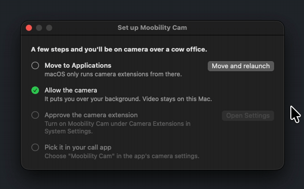
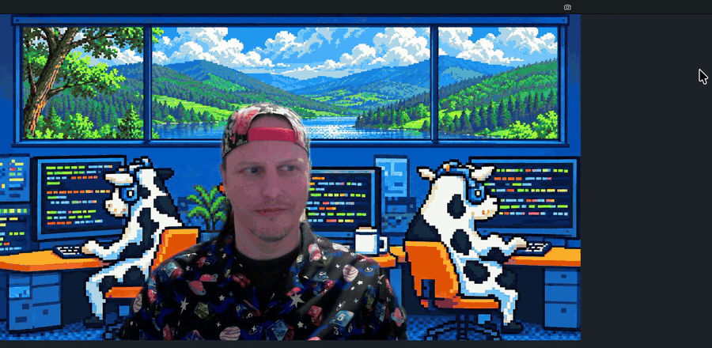
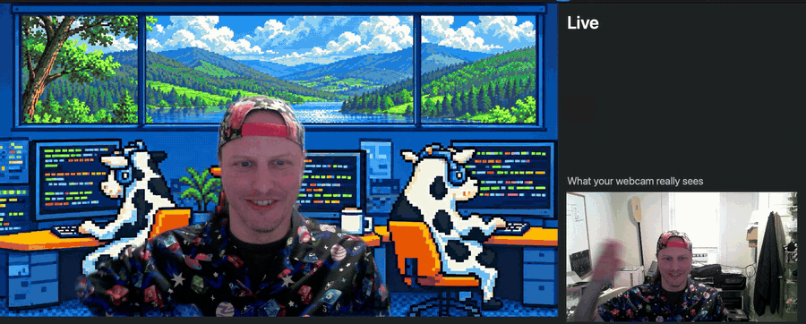

# Moobility Cam

A free macOS virtual camera. It puts you over a background that changes on its own with the seasons, the days you pick and the holidays you care about. It can also loop a clip of you into a call.

It works in Zoom, Google Meet, FaceTime and anything else that lets you choose a camera. Everything runs on your Mac. The only network use is checking for updates.

**[Download Moobility Cam](https://github.com/MobilityLabs/moobility-cam/releases/latest/download/Moobility-Cam.dmg)**. Needs macOS 14 or later. It's built for Apple silicon and Intel, but it hasn't been tested on an Intel Mac yet.

## First run

Open the DMG, then open Moobility Cam. A setup window walks you through four steps:

1. Move it to Applications.
2. Allow the camera.
3. Turn on Moobility Cam under Camera Extensions in System Settings.
4. Choose "Moobility Cam" as the camera in your call app.

It lives in the menu bar and starts at login.



## What it does

- **Backgrounds.** Four built-in seasons of cows, or your own photos in `~/Pictures/Moobility Cam`. Give a photo dates, days and times, or a holiday, and it shows up when it should.

  

- **Camera modes.** You over a background, plain camera, or background only with the webcam off.

  

- **Replay.** Press ⌃⌥⌘R to loop the last minute, and press it again to go live. You can pick another length, or a clip you recorded in advance. Clips have no sound, and your microphone keeps working as usual, so mute yourself in your call app if you step away.

  

Recent video stays in memory and is wiped when no app is using the camera. Nothing reaches the disk unless you record or keep a clip, in `~/Movies/Moobility Cam`.

## Updates

Moobility Cam updates itself. When an update changes the camera extension, macOS can need a restart to finish it, and the menu says so if it does.

## Removing it

Quit it from the menu bar and move it to the Trash. macOS removes the camera extension with it.

## Building

You need Xcode and [XcodeGen](https://github.com/yonaskolb/XcodeGen).

```sh
swift test --package-path MoobilityCore   # unit tests
scripts/check-build.sh                    # generate the project, build and check it
```

Camera extensions only run from `/Applications`, and only when signed by a team that can install them.

Art comes from `raw/`. `scripts/compose-defaults.py` builds the seasons and the idle image, and `scripts/compose-icon.py` builds the icon.

## Forks

Use your own name and icon. The Moobility names and logos aren't covered by the license. These have to change together:

| What | Where |
|---|---|
| Team and bundle IDs | `project.yml`, `scripts/ExportOptions.plist`, `scripts/verify-release.sh`, `scripts/make-profiles.py` |
| App's bundle ID and install path, which the extension accepts frames from | `Extension/ClientCheck.swift`, `App/AppModel.swift` |
| Extension's bundle ID and Mach service | `App/ExtensionInstaller.swift`, `Extension/Info.plist` |
| Device and stream IDs, so a fork can sit beside this app | `Extension/Constants.swift`, `App/CMIOLookup.swift` |
| Client-count selector | `Extension/Constants.swift`, `App/CMIOLookup.swift` |
| Update feed and public key | `project.yml`, `.github/workflows/release.yml` |
| Repository name, used by both workflows and the setup script | `.github/workflows/`, `scripts/configure-release-ci.sh` |
| Signing identity, profiles, notary key and vault | `scripts/build-release.sh`, `scripts/make-profiles.py`, `scripts/configure-release-ci.sh`, `.github/workflows/release.yml` |

`IdentityConsistencyTests` checks that the duplicated values agree.

## Releasing

Pushing a `vX.Y.Z` tag builds, signs, notarizes and publishes a release. A manual run of the `release` workflow does everything except publish. Raise `EXTENSION_BUILD` in `project.yml` only when `Extension/` changes, because replacing a running extension can need a restart. The workflow fails if you forget. The signing secrets live in a `release` environment that only `main` and `v*` tags can use.

## How the camera is protected

Only the app installed at `/Applications/MoobilityCam.app`, signed by the same team with the expected identifier and the hardened runtime, can feed the camera. The extension's sandbox rules out the Security framework's checks, so it asks the kernel about the running process through `csops`, which is exported but has no public header. The kernel doesn't check who issued a signature, so the path matters: macOS's App Management protection stops another developer's app replacing a notarized app there, unless you've given that app permission. If any of this stops working, the extension refuses every client rather than accepting them.

## License

MIT. See [LICENSE](LICENSE) and [THIRD-PARTY.md](THIRD-PARTY.md).
